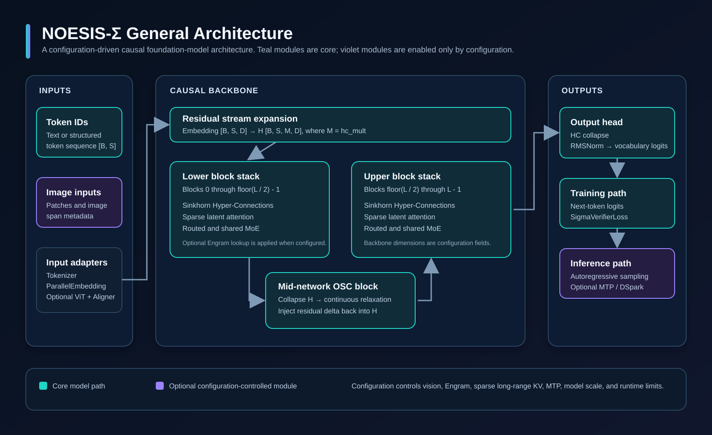
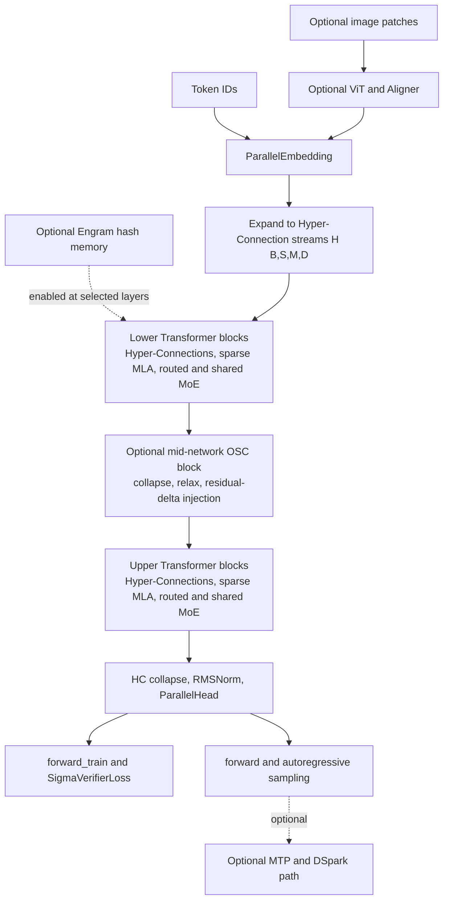
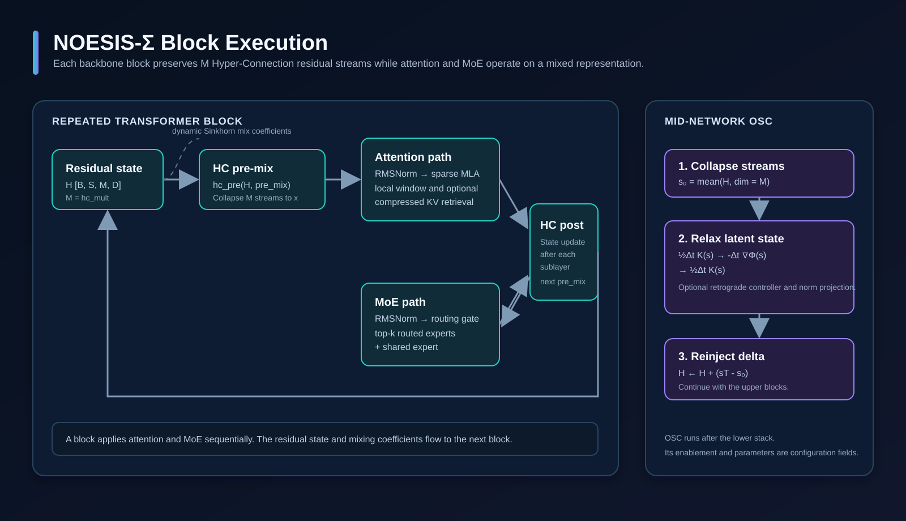
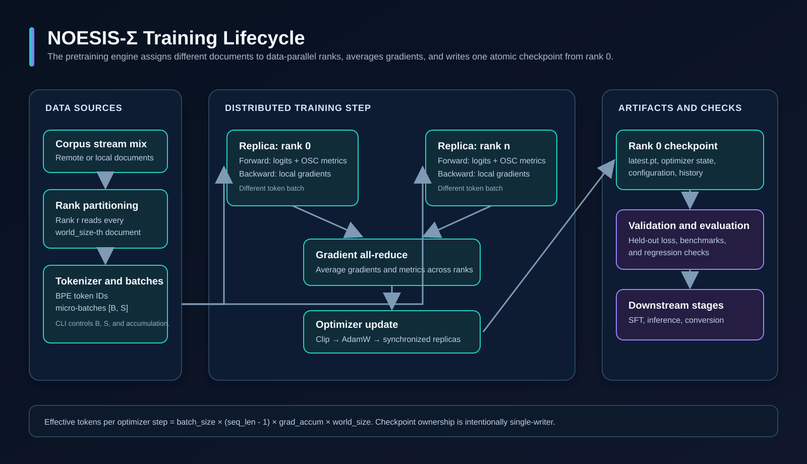
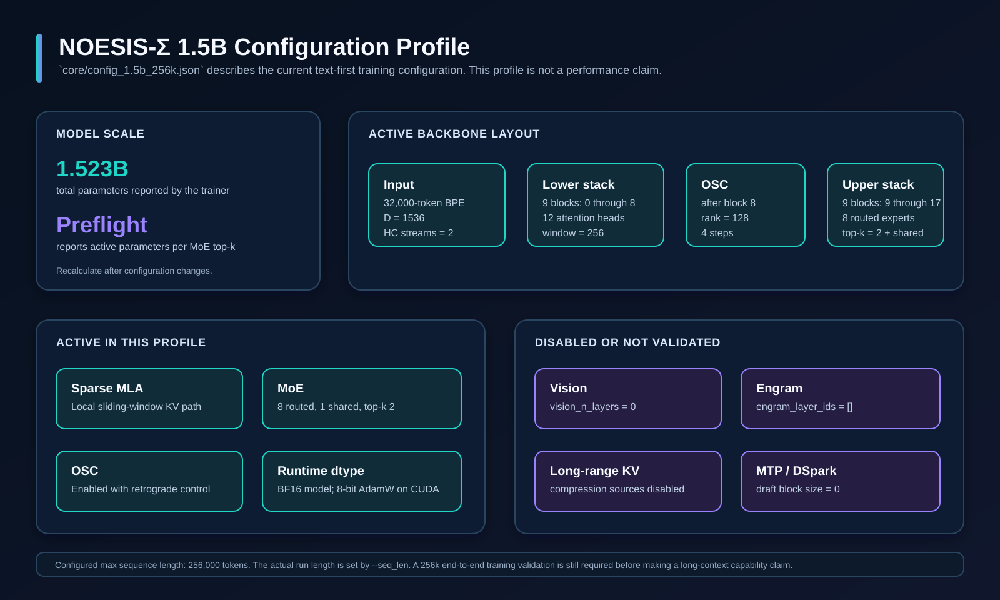

# NOESIS-Σ (Sigma) - HiBred

<p align="center">
  
</p>

<p align="center">
  <strong>Configuration-driven causal foundation-model architecture</strong><br>
  Hyper-Connections, sparse latent attention, mixture of experts, and an optional operator-split continuous block.
</p>

[](LICENSE)
[](core/requirements.txt)
[](core/requirements.txt)
[](.github/workflows/quality.yml)

```text
███╗   ██╗ ██████╗ ███████╗███████╗██╗███████╗      ███████╗
████╗  ██║██╔═══██╗██╔════╝██╔════╝██║██╔════╝      ██╔════╝
██╔██╗ ██║██║   ██║█████╗  ███████╗██║███████╗█████╗███████╗
██║╚██╗██║██║   ██║██╔══╝  ╚════██║██║╚════██║╚════╝╚════██║
██║ ╚████║╚██████╔╝███████╗███████║██║███████║      ███████║
╚═╝  ╚═══╝ ╚═════╝╚══════╝╚══════╝╚═╝╚══════╝      ╚══════╝
```

NOESIS-Σ is an experimental research implementation of a causal foundation-model
architecture. The repository contains the model, training engine, evaluation
tools, quality checks, and technical documentation. Architecture components are
configuration-controlled. A component documented below is not necessarily
enabled in every model profile.

## Architecture at a glance



### Mermaid architecture map



The general forward path is:

```text
tokens and optional image spans
  → embedding and optional vision alignment
  → M Hyper-Connection residual streams
  → lower Transformer blocks
  → optional mid-network OSC relaxation
  → upper Transformer blocks
  → Hyper-Connection collapse, RMSNorm, vocabulary logits
```

The `ModelArgs` configuration selects the model scale and the optional paths.
The canonical implementation is [`core/model.py`](core/model.py).

| Subsystem | Implemented role | Configuration control |
| :--- | :--- | :--- |
| Token embedding | Maps token IDs to the initial residual state. | Always present. |
| Hyper-Connections | Maintains `hc_mult` residual streams and learns pre, post, and combination mixes. | `hc_mult`, Sinkhorn parameters. |
| Sparse latent attention | Applies causal local attention and can retrieve compressed KV latents. | Window, compression, indexer, and source-layer fields. |
| Mixture of experts | Combines routed top-k SwiGLU experts with shared experts. | Expert count, active experts, score function. |
| OSC block | Relaxes a collapsed mid-network state and injects its residual delta. | `osc_enabled` and OSC parameters. |
| Engram memory | Adds n-gram hash memory to selected blocks. | `engram_layer_ids` and related fields. |
| Vision tower | Encodes image patches and replaces image-token embedding spans. | `vision_n_layers`; zero disables it. |
| MTP / DSpark | Supplies an optional speculative draft path. | `dspark_block_size`; zero disables it. |

## Block-level execution



Each `Block` runs attention and mixture-of-experts sublayers in sequence. A
Hyper-Connection pre-mix produces a sublayer input from the residual streams;
the post-mix writes the sublayer result back into those streams. The OSC block,
when enabled, is inserted after the lower half of the backbone:

```text
H [B, S, M, D]
  → s0 = mean(H, dim=M)
  → operator-split OSC relaxation
  → H + (sT - s0)
```

The OSC implementation is in [`core/osc_block.py`](core/osc_block.py). The
loss implementation is in [`core/verifier_loss.py`](core/verifier_loss.py).
The model does not treat OSC diagnostics as evidence of model quality; held-out
evaluation is required for that purpose.

## Training system



[`scripts/pretrain_1.5b_production.py`](scripts/pretrain_1.5b_production.py)
implements the current multi-corpus trainer. For data-parallel training, every
rank receives a distinct document stride, computes local gradients, and joins
the same gradient all-reduce. Consequently, all replicas make the same optimizer
update. Rank 0 alone writes `latest.pt`; separate checkpoints per GPU would be
duplicate copies of the same synchronized model state.

Effective tokens per optimizer step are:

```text
batch_size × (seq_len - 1) × grad_accum × world_size
```

The trainer records total loss, language-model loss, OSC diagnostics, token
throughput, memory, optimizer state, configuration, and training history.
Multi-GPU runs use FSDP `FULL_SHARD` with fp32 master weights and fp32 AdamW
moments. Single-GPU smoke runs can use 8-bit AdamW when that dependency is
available; the distributed path does not depend on it.

## 1.5B production profile

The source of truth for production training is
[`core/config_1.5b_production_256k.json`](core/config_1.5b_production_256k.json).
It keeps every implemented text feature enabled at once and disables vision.



| Area | 1.5B production profile state |
| :--- | :--- |
| Backbone | 18 blocks, `dim=1536`, 12 attention heads, 32,000-token vocabulary, `hc_mult=2`. |
| MoE | 8 routed experts, 1 shared expert, 2 routed experts selected per token. |
| OSC | Enabled, with a rank and ICNN width chosen for the 1.5B budget. |
| Attention | Local sliding-window attention (`window_size=256`) plus compressed KV at 8-to-1 with an indexer. Index queries are scored every fourth position (`index_query_stride=4`). |
| Engram memory | Enabled at backbone blocks 3, 9, and 15 with a tokenizer-derived compressed vocabulary. |
| MTP / DSpark | Enabled with a two-token draft block targeting backbone blocks 9 and 15. Training includes teacher-forced draft cross-entropy and confidence calibration. |
| Vision | Disabled with `vision_n_layers=0`. |
| Context | `max_seq_len=262144` total prompt plus output. Outputs of 64K to 128K tokens are generated when the prompt leaves room. |
| Parallelism | FSDP `FULL_SHARD` over 8 ranks with logical model-parallel size 1. |

The trainer reports total parameters and active parameters per token at
startup. The production profile reports 1,517,979,352 total parameters and
714,344,152 active parameters per token. The report is the source of truth
after every architectural change.

### How the 262,144-token context fits on 8 x 16 GB

Training processes `chunk_len` tokens at a time and carries state across
chunks: sliding-window KV, compressed KV, indexer keys, the OSC retrograde
state, and MTP draft cache. Per-chunk memory is independent of the outer
context length. Each rank shards parameters, gradients, and AdamW moments with
FSDP, so a 1.5B fp32 master model costs about 0.71 GiB of master weights,
0.71 GiB of gradients, 1.41 GiB of AdamW state, and 0.35 GiB of all-gather
buffer. Attention caches at 262K are about 0.14 GiB per rank.

The differentiable horizon is `chunk_len * bptt_chunks`, which defaults to
32,768 tokens. Carried attention caches are functional state and are detached
at chunk boundaries; the OSC retrograde state also carries a truncated graph.
Full 262K backpropagation is not feasible on 16 GB GPUs without context
parallelism, and the trainer does not claim it. See
[`docs/09_LONG_CONTEXT_TRAINING.md`](docs/09_LONG_CONTEXT_TRAINING.md).

### Preflight, training, export, and generation

Run the hardware preflight before an 8-GPU launch:

```bash
python scripts/check_hardware.py \
  --config core/config_1.5b_production_256k.json \
  --seq_len 262144 --chunk_len 4096 --bptt_chunks 4 --world_size 8
```

The preflight reports GPU memory, parameter counts, cache sizes, the FSDP
memory plan, and a recommended chunk length. It exits non-zero on a hard
incompatibility.

```bash
export PYTORCH_CUDA_ALLOC_CONF=expandable_segments:True
export NOESIS_CODE_DATASET=codeparrot/github-code
export NOESIS_CODE_DATA_FILES="hf://datasets/codeparrot/github-code/data/train-00000-of-01126.parquet"

python -m torch.distributed.run --standalone --nproc_per_node=8 \
  scripts/pretrain_1.5b_production.py \
  --config core/config_1.5b_production_256k.json \
  --steps 25000 \
  --batch_size 1 \
  --seq_len 262144 \
  --chunk_len 4096 \
  --bptt_chunks 4 \
  --lr 3e-4 \
  --save_interval 500 \
  --output_dir checkpoints/noesis_sigma_1.5b
```

Export an inference directory and generate with it:

```bash
python scripts/export_checkpoint.py --checkpoint checkpoints/noesis_sigma_1.5b
python core/generate.py \
  --ckpt-path checkpoints/noesis_sigma_1.5b/exported \
  --input-file examples/example.txt \
  --max-new-tokens 65536 \
  --prefill-chunk 8192
```

Production data streams fail closed by default. If a corpus, authentication
token, or network connection fails, correct that data-source issue before
continuing. `--allow_synthetic_fallback` is reserved for offline smoke tests.
`--dry_data` remains available for shape-only runs.

Without `--dry_data`, the trainer opens live Hugging Face streaming iterators
for FineWeb-Edu, Cosmopedia-v2, the configured public Python Parquet shard,
GSM8K, and Glaive Function Calling v2. The document schedule is 40/20/20/10/10.
Each data-parallel rank uses a distinct document stride. Remote HTTP errors or
gated datasets stop a production run instead of changing the corpus silently.
`scripts/build_tokenized_corpus.py` can instead tokenize the blend once into
memory-mapped shards for resumable, network-free production runs.

### Related profiles

- [`core/config_1.5b.json`](core/config_1.5b.json) keeps the same architecture with a 1M context limit for validation.
- [`core/config_1.5b_256k.json`](core/config_1.5b_256k.json) is identical except for `max_seq_len=256000`.
- [`core/config_1.5b_full_text_256k.json`](core/config_1.5b_full_text_256k.json) is a legacy full-text alias retained for existing experiments; new runs should use the production profile.

`forward_spec` exposes draft proposals for an active MTP profile. The standard
`generate.py` loop does not yet contain an acceptance and rollback scheduler,
so the production profile does not make an inference-speedup claim. The MTP
head is nevertheless constructed, trained, checkpointed, and covered by a
teacher-forced regression test.

## Verification and quality gates

Install the runtime dependencies and run the full validation suite:

```bash
pip install -r core/requirements.txt
pip install -r requirements-dev.txt
python scripts/quality_gate.py
```

Install Git hooks once after cloning:

```bash
pre-commit install --hook-type pre-commit --hook-type pre-push
pre-commit run --all-files
```

The quality gate compiles project Python files, validates examples, checks
documentation style, runs the test suite, and enforces coverage thresholds.
GitHub Actions runs the same quality gate on pushes and pull requests.

## Repository guide

```text
core/          Model, OSC block, kernels, tokenizer, inference utilities, configurations
scripts/       Pretraining, SFT, evaluation, ablation, and quality-gate commands
assets/        Logo and architecture diagrams used by this README
examples/      Validated prompts, small corpus, evaluation cases, and media
tests/         Unit, integration, CLI, corpus, and documentation tests
docs/          Design, mathematics, module reference, training, testing, and research notes
checkpoints/   Tokenizer artifacts; trained weight files are intentionally ignored by Git
```

## Technical documentation

- [Architecture and System Design](docs/01_ARCHITECTURE_AND_DESIGN.md)
- [Mathematical Specification](docs/02_MATHEMATICAL_SPECIFICATION_OSC.md)
- [Module Reference](docs/03_MODULE_REFERENCE.md)
- [Pretraining and Inference Guide](docs/04_PRETRAINING_AND_INFERENCE_GUIDE.md)
- [Testing and Verification](docs/05_TESTING_AND_VERIFICATION_REPORT.md)
- [Controlled Ablation Study](docs/06_ABLATION_STUDY_REPORT.md)
- [Research and Compute Planning](docs/07_PUBLICATION_AND_COMPUTE_STRATEGY.md)
- [Kaggle Training and Evaluation Blueprint](docs/08_KAGGLE_1B_RESEARCH_BLUEPRINT.md)
- [Documentation Index](docs/README.md)

## Citation

```bibtex
@software{noesis_sigma_2026,
  title   = {NOESIS-Σ: An Operator-Split Continuous Dynamical Language and Multimodal Foundation Architecture},
  author  = {NOESIS-Σ Contributors},
  year    = {2026},
  url     = {https://github.com/sainibhaowal/NOESIS-SIGMA},
  license = {Apache-2.0}
}
```

## License

This project is licensed under the [Apache License, Version 2.0](LICENSE).
