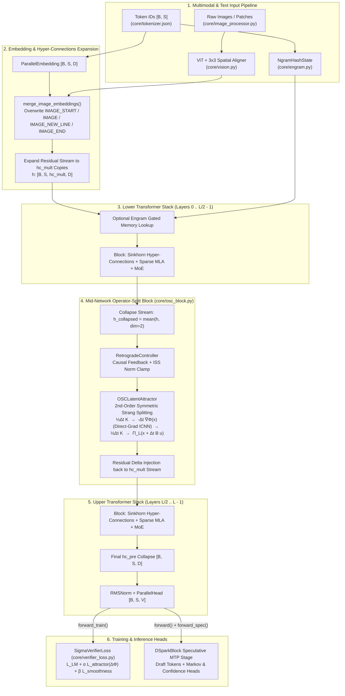
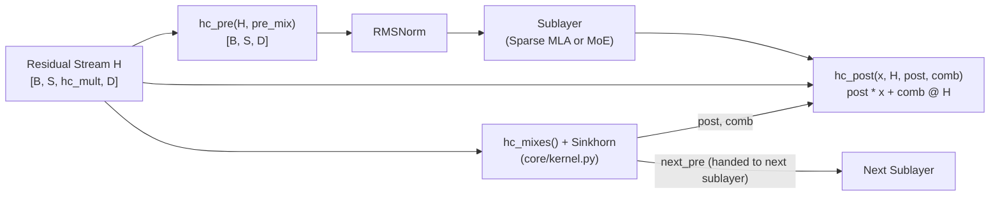
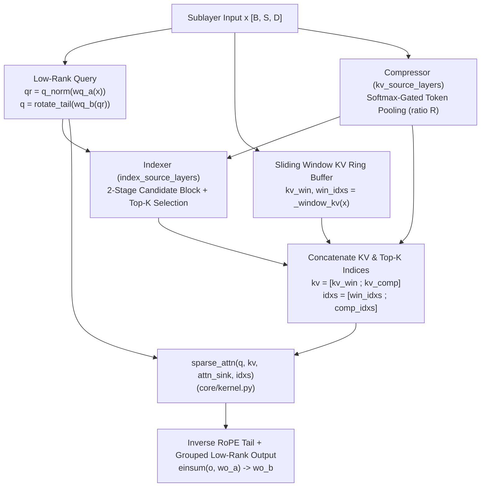

# NOESIS-Σ: Architecture and System Design

**NOESIS-Σ (Sigma)** is a hybrid discrete-continuous foundation model
architecture implemented in [`core/`](../core). It combines causal Transformer
components, including Multi-Head Latent Attention, Sinkhorn Hyper-Connections,
routed and shared mixture-of-experts layers, Engram hash memory, optional
vision modules, and speculative decoding. The mid-network operator-split block
is implemented in [`core/osc_block.py`](../core/osc_block.py).

---

## 1. Macro Architecture Dataflow

---

## 2. Core Architectural Subsystems

### 2.1 Doubly-Stochastic Sinkhorn Hyper-Connections (`Block`)

Instead of a single residual stream $\mathbf{h} \in \mathbb{R}^{B \times S \times D}$, NOESIS-Σ maintains `hc_mult` parallel residual streams $\mathbf{H} \in \mathbb{R}^{B \times S \times M \times D}$ ($M = \text{hc\_mult}$).

Before each Attention or MoE sublayer, [`Block.hc_mixes`](../core/model.py) projects the normalized flattened stream into three sets of dynamic routing coefficients via [`hc_split_sinkhorn`](../core/kernel.py):
1. **`pre` ($\in \mathbb{R}^{B \times S \times M}$):** Collapses the $M$ streams into a single sublayer input $\mathbf{x} = \sum_{m=1}^M \text{pre}_m \mathbf{H}_m$.
2. **`post` ($\in \mathbb{R}^{B \times S \times M}$):** Scales the sublayer output back across the $M$ streams.
3. **`comb` ($\in \mathbb{R}^{B \times S \times M \times M}$):** Mixes the $M$ residual streams via a matrix normalized through alternating row/column **Sinkhorn iterations** so that `comb` is doubly stochastic ($\sum_i \text{comb}_{ij} = 1, \sum_j \text{comb}_{ij} = 1$).

---

### 2.2 Two-Level Sparse Multi-Head Latent Attention (`Attention`, `Compressor`, `Indexer`)

[`Attention`](../core/model.py) combines low-rank query/output projections (`wq_a`, `wq_b`, grouped `wo_a`, `wo_b`) with a dual-source key-value memory:

1. **Local Sliding-Window KV Ring Buffer (`_window_kv`):**
   - Stores the most recent `window_size` tokens in a circular buffer with YaRN Rotary Position Embeddings (`rotate_tail` / `apply_rotary_emb`) applied to the last `rope_head_dim` dimensions.
2. **Compressed Long-Range KV Cache (`Compressor` + `Indexer`):**
   - When `compress_ratio > 0` on a source layer (`kv_source_layers`), [`Compressor`](../core/model.py) pools every `compress_ratio` consecutive tokens into a single latent vector using a learned softmax gate (`wgate`).
   - [`Indexer`](../core/model.py) scores compressed latents against low-dimensional query heads (`index_n_heads`, `index_head_dim`) and selects the top-`index_topk` historical compressed positions per query (optionally filtered through two-level block selection via [`select_candidate_blocks`](../core/model.py)).
3. **Learnable Attention Sink (`sparse_attn`):**
   - [`sparse_attn`](../core/kernel.py) gathers the selected local window and compressed KV positions and appends a learnable per-head attention sink logit (`attn_sink`) to the softmax denominator, allowing heads to absorb unused probability mass without corrupting hidden states.

---

### 2.3 Top-$k$ Routed + Shared Mixture-of-Experts (`Gate`, `Expert`, `MoE`)

Every [`Block`](../core/model.py) uses a [`MoE`](../core/model.py) feed-forward network consisting of:
- **Routing [`Gate`](../core/model.py):** Computes expert affinity scores via `softmax`, `sigmoid`, or `sqrtsoftplus` ($\sqrt{\text{softplus}(s)}$). Selection uses an additive load-balancing bias (`bias` for text tokens, `bias_vl` for image-span tokens), while routing weights come from the unbiased scores.
- **Routed [`Expert`](../core/model.py) Modules:** `n_routed_experts` SwiGLU FFNs (`w1`, `w2`, `w3`) with activation clamping (`swiglu_limit`) to prevent numerical spikes in low-precision (`bf16`/`fp8`/`fp4`) regimes. Each token activates `n_activated_experts`.
- **Always-Active Shared Expert (`shared_experts`):** One shared SwiGLU expert processes every token unconditionally.

---

### 2.4 Engram $N$-Gram Hash Memory (`engram.py`)

When `engram_layer_ids` is configured, [`NgramHashState`](../core/engram.py) maps input tokens into a case/accent-normalized compressed vocabulary (`build_compressed_token_map`) and computes rolling XOR-multiplicative hashes over $2$-grams through `max_ngram_size`-grams modulo disjoint prime-sized bucket ranges (`EngramLayout`).
- Image spans are marked as `DEAD = -1` so $n$-grams never cross image boundaries.
- [`Engram`](../core/model.py) fetches the hashed rows from `ParallelEngramEmbedding` and gates their value contribution into each Hyper-Connection copy via a signed-square-root sigmoid dot-product gate.

---

### 2.5 Multimodal Vision Tower (`vision.py` & `image_processor.py`)

When `vision_n_layers > 0` (`args.vision_enabled == True`):
1. [`image_processor.py`](../core/image_processor.py) resizes images while preserving aspect ratio within `vision_max_n_token` (`plan_image_grid`, `safe_resize`, `solve_resize_ratio`) and extracts `n_vit_h x n_vit_w` patches.
2. [`ViT`](../core/vision.py) processes the patches with full bidirectional attention and **2D Axial Rotary Position Embeddings** (`get_vision_cos_sin`).
3. [`Aligner`](../core/vision.py) applies a `downsample_ratio x downsample_ratio` (`3x3`) spatial unfold + 2-layer GELU MLP to project visual features into the LLM embedding dimension `dim`.
4. [`Transformer.merge_image_embeddings`](../core/model.py) populates the token span `[IMAGE_START] + ([IMAGE] * n_llm_w + [IMAGE_NEW_LINE]) * n_llm_h + [IMAGE_END]`.

---

### 2.6 DSpark Speculative Multi-Token Prediction (`DSparkBlock`)

When `dspark_block_size > 0`, [`Transformer.forward_spec`](../core/model.py) runs a lightweight speculative draft stage (`mtp` modules):
- Reads concatenated intermediate representations from `dspark_target_layer_ids`.
- Predicts `dspark_block_size` draft tokens in parallel using [`DSparkAttention`](../core/model.py), refining sequential transitions through [`DSparkMarkovHead`](../core/model.py) and emitting per-position acceptance confidence scores via [`DSparkConfidenceHead`](../core/model.py).

---

## 3. Configuration Reference (`ModelArgs`)

The current repository contains a 1.5B configuration and a large reference
configuration. The reference configuration is not an approved local or Kaggle
training target.

| Parameter Group | Key Parameters | `config_1.5b_256k.json` | `config_671b.json` reference |
| :--- | :--- | :--- | :--- |
| **Backbone dimensions** | `vocab_size`, `dim`, `n_layers`, `n_heads` | `32000`, `1536`, `18`, `12` | `32000`, `7168`, `61`, `128` |
| **Operator-split block** | `osc_enabled`, `osc_rank`, `osc_icnn_hidden`, `osc_steps`, `osc_dt`, `osc_c_min` | `true`, `128`, `512`, `4`, `0.08`, `0.01` | `true`, `256`, `1024`, `4`, `0.08`, `0.01` |
| **Hyper-Connections** | `hc_mult` | `2` | `2` |
| **MLA and sparse KV** | `q_lora_rank`, `head_dim`, `rope_head_dim`, `o_groups`, `o_lora_rank`, `window_size` | `384`, `128`, `64`, `4`, `384`, `256` | `1536`, `128`, `64`, `8`, `1536`, `256` |
| **Mixture of Experts** | `moe_inter_dim`, `n_routed_experts`, `n_shared_experts`, `n_activated_experts`, `score_func` | `1792`, `8`, `1`, `2`, `"sqrtsoftplus"` | `2048`, `256`, `1`, `8`, `"sqrtsoftplus"` |
| **Runtime** | `dtype`, `max_batch_size`, `max_seq_len`, `vision_n_layers` | `"bf16"`, `8`, `256000`, `0` | `"bf16"`, `8`, `1048576`, `0` |
