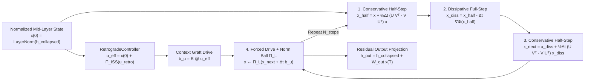

# NOESIS-Σ: Mathematical Specification of the Operator-Split Cognitive Engine (OSC) & Verifier Loss

This document specifies the continuous-time dynamical systems mathematics implemented in [`core/osc_block.py`](../core/osc_block.py) and [`core/verifier_loss.py`](../core/verifier_loss.py).

---

## 1. Continuous-Time Conservative-Dissipative State Equation

At the midpoint of the NOESIS-Σ Transformer stack ($l_{\text{mid}} = \lfloor L/2 \rfloor - 1$), the Hyper-Connections residual stream $\mathbf{H} \in \mathbb{R}^{B \times S \times M \times d}$ is collapsed across its $M = \text{hc\_mult}$ copies into $\mathbf{h}_0 = \frac{1}{M}\sum_{m=1}^M \mathbf{H}_m \in \mathbb{R}^{B \times S \times d}$.

After LayerNorm $\mathbf{x}(0) = \text{LN}(\mathbf{h}_0)$, the latent state
$\mathbf{x}(\tau) \in \mathbb{R}^d$ evolves over internal integration time
$\tau \in [0, N_{\text{steps}} \Delta t]$ according to the forced
conservative-dissipative ordinary differential equation:

$$
\frac{d\mathbf{x}}{d\tau} = \underbrace{\mathbf{K}\mathbf{x}(\tau)}_{\text{Conservative Hamiltonian Rotation}} - \underbrace{\nabla_{\mathbf{x}} \Phi(\mathbf{x}(\tau))}_{\text{Dissipative Attractor Gradient}} + \underbrace{\mathbf{B}\mathbf{u}_{\text{eff}}}_{\text{Context + Retrograde Drive}}
$$

subject to norm-ball projection $\|\mathbf{x}(\tau)\|_2 \le L_{\max}$.

---

## 2. Low-Rank Skew-Symmetric Conservative Operator ($\mathbf{K}$)

To enable oscillatory phase exploration across latent feature subspaces without injecting or destroying energy, $\mathbf{K} \in \mathbb{R}^{d \times d}$ is parameterized via two rank-$r$ matrices $\mathbf{U}, \mathbf{V} \in \mathbb{R}^{d \times r}$ (`u_proj`, `v_proj`):

$$
\mathbf{K} = \mathbf{U}\mathbf{V}^\top - \mathbf{V}\mathbf{U}^\top
$$

### Mathematical Guarantees
1. **Strict Skew-Symmetry:**
   $$
   \mathbf{K}^\top = (\mathbf{U}\mathbf{V}^\top - \mathbf{V}\mathbf{U}^\top)^\top = \mathbf{V}\mathbf{U}^\top - \mathbf{U}\mathbf{V}^\top = -\mathbf{K}
   $$
2. **Zero Energy Production (Conservation Law):**
   For any state $\mathbf{x} \in \mathbb{R}^d$:
   $$
   \langle \mathbf{x}, \mathbf{K}\mathbf{x} \rangle = \mathbf{x}^\top \mathbf{K} \mathbf{x} = \frac{1}{2}\mathbf{x}^\top(\mathbf{K} + \mathbf{K}^\top)\mathbf{x} = 0
   $$
   This identity is explicitly tested in [`tests/test_osc_and_verifier.py`](../tests/test_osc_and_verifier.py).
3. **$\mathcal{O}(dr)$ Complexity:**
   Evaluated in [`OSCLatentAttractor._skew_step`](../core/osc_block.py#L190-L196) as $\mathbf{U}(\mathbf{V}^\top \mathbf{x}) - \mathbf{V}(\mathbf{U}^\top \mathbf{x})$ without materializing the dense $d \times d$ matrix.

---

## 3. Canonical Hybrid Input-Convex Potential (`CanonicalICNNDirectGrad`)

The dissipative potential $\Phi: \mathbb{R}^d \to \mathbb{R}$ in [`CanonicalICNNDirectGrad`](../core/osc_block.py#L30-L106) combines a non-negative softplus ridge stack, a strongly convex diagonal quadratic form, a low-rank quadratic coupling, and a learned linear drift prior $\mathbf{c} \in \mathbb{R}^d$:

$$
\Phi(\mathbf{x}) = \sum_{i=1}^{m} a_i \,\text{softplus}(\mathbf{w}_i^\top \mathbf{x} + b_i) + \frac{1}{2} \sum_{j=1}^{d} D_j x_j^2 + \frac{1}{2} \|\mathbf{V}_{\Phi}^\top \mathbf{x}\|_2^2 + \mathbf{c}^\top \mathbf{x}
$$

where positivity and strong convexity are enforced by construction:
- $a_i = \text{softplus}(a_{\text{raw}, i}) > 0 \quad (\forall i \in \{1, \dots, m\})$
- $D_j = \text{softplus}(D_{\text{raw}, j}) + c_{\min} \ge c_{\min} > 0 \quad (\forall j \in \{1, \dots, d\})$

### 3.1 Exact Closed-Form Analytical Gradient ($\nabla\Phi(\mathbf{x})$)

Because $\frac{d}{dz}\text{softplus}(z) = \sigma(z) = \frac{1}{1 + e^{-z}}$, the gradient $\nabla_{\mathbf{x}} \Phi(\mathbf{x})$ has an **exact closed-form expression** requiring **zero nested autograd graph construction** during the forward ODE loop:

$$
\nabla_{\mathbf{x}} \Phi(\mathbf{x}) = \mathbf{W}^\top \!\Big(\mathbf{a} \odot \sigma(\mathbf{W}\mathbf{x} + \mathbf{b})\Big) + \mathbf{D} \odot \mathbf{x} + \mathbf{V}_{\Phi}\big(\mathbf{V}_{\Phi}^\top \mathbf{x}\big) + \mathbf{c}
$$

### 3.2 $c_{\min}$-Strong Convexity Proof

The Hessian $\nabla^2_{\mathbf{x}} \Phi(\mathbf{x})$ is given by:

$$
\nabla^2_{\mathbf{x}} \Phi(\mathbf{x}) = \mathbf{W}^\top \operatorname{diag}\!\Big(\mathbf{a} \odot \sigma(\mathbf{W}\mathbf{x}+\mathbf{b}) \odot \big(1 - \sigma(\mathbf{W}\mathbf{x}+\mathbf{b})\big)\Big) \mathbf{W} + \operatorname{diag}(\mathbf{D}) + \mathbf{V}_{\Phi}\mathbf{V}_{\Phi}^\top
$$

Since $a_i > 0$, $\sigma(z)(1-\sigma(z)) > 0$, $\mathbf{V}_{\Phi}\mathbf{V}_{\Phi}^\top \succeq \mathbf{0}$, and $D_j \ge c_{\min} > 0$:

$$
\nabla^2_{\mathbf{x}} \Phi(\mathbf{x}) \succeq c_{\min} \mathbf{I}_d \succ \mathbf{0} \quad \forall \mathbf{x} \in \mathbb{R}^d
$$

Thus $\Phi(\mathbf{x})$ is globally $c_{\min}$-strongly convex and possesses a unique global minimum basin $\mathbf{x}^*$.

---

## 4. 2nd-Order Symplectic Symmetric Strang Splitting

Each step $k \in \{1, \dots, N_{\text{steps}}\}$ in [`OSCLatentAttractor.forward`](../core/osc_block.py#L198-L240) integrates the coupled conservative and dissipative operators via **Symmetric Strang Splitting** with local truncation error $\mathcal{O}(\Delta t^3)$ and global accuracy $\mathcal{O}(\Delta t^2)$:

$$
\begin{aligned}
\mathbf{x}^{(k + 1/3)} &= \mathbf{x}^{(k)} + \frac{\Delta t}{2} \mathbf{K} \mathbf{x}^{(k)} && \text{(1. Conservative half-step)} \\[4pt]
\mathbf{x}^{(k + 2/3)} &= \mathbf{x}^{(k + 1/3)} - \Delta t \,\nabla_{\mathbf{x}}\Phi\!\left(\mathbf{x}^{(k + 1/3)}\right) && \text{(2. Dissipative full-step)} \\[4pt]
\mathbf{x}^{(k + 1)}_{\text{split}} &= \mathbf{x}^{(k + 2/3)} + \frac{\Delta t}{2} \mathbf{K} \mathbf{x}^{(k + 2/3)} && \text{(3. Conservative half-step)} \\[4pt]
\mathbf{x}^{(k + 1)} &= \Pi_{L_{\max}}\!\Big(\mathbf{x}^{(k + 1)}_{\text{split}} + \Delta t \,\mathbf{B}\mathbf{u}_{\text{eff}}\Big) && \text{(4. Context drive + norm ball projection)}
\end{aligned}
$$

where the norm-ball projection operator $\Pi_{L_{\max}}$ constrains the norm of
the updated hidden state:

$$
\Pi_{L_{\max}}(\mathbf{z}) = \mathbf{z} \cdot \min\!\left(1, \frac{L_{\max}}{\max(\|\mathbf{z}\|_2, 10^{-6})}\right)
$$

---

## 5. Coupled Retrograde Causal Feedback Controller (`RetrogradeController`)

To damp abrupt token-to-token state jumps along the sequence dimension $t \in \{0, \dots, S-1\}$, [`RetrogradeController`](../core/osc_block.py#L109-L147) projects hidden states via $\mathbf{u}_t = \mathbf{W}_{\text{retro}} \mathbf{h}_t$ and computes the causal first-order difference with exponential decay $\lambda \in (0, 1)$:

$$
\mathbf{r}_t = \begin{cases}
\mathbf{0} & \text{if } t = 0 \\[4pt]
\alpha \lambda (\mathbf{u}_t - \mathbf{u}_{t-1}) & \text{if } t \ge 1
\end{cases}
$$

The implementation clamps $\|\mathbf{u}_{\text{retro}, t}\|_2 \le u_{\max}$
to enforce the configured bound:

$$
\mathbf{u}_{\text{retro}, t} = \mathbf{r}_t \cdot \min\!\left(1, \frac{u_{\max}}{\max(\|\mathbf{r}_t\|_2, 10^{-8})}\right)
$$

Because $\mathbf{r}_t$ depends exclusively on $\{t-1, t\}$, it preserves strict autoregressive causality ($t$ never reads $t' > t$).

---

## 6. Multi-Objective Verifier & Attractor Loss (`SigmaVerifierLoss`)

During training, [`SigmaVerifierLoss`](../core/verifier_loss.py#L18-L70) optimizes a composite objective over next-token logits $\hat{\mathbf{Y}} \in \mathbb{R}^{B \times S \times V}$, targets $\mathbf{Y} \in \{0, \dots, V-1\}^{B \times S}$, OSC energy metrics $\Delta\Phi = \Phi(\mathbf{x}(T)) - \Phi(\mathbf{x}(0))$, and final hidden states $\mathbf{H}_{\text{out}} \in \mathbb{R}^{B \times S \times d}$:

$$
\mathcal{L}_{\text{total}} = \mathcal{L}_{\text{LM}} + \alpha_{\text{attr}} \mathcal{L}_{\text{attractor}} + \beta_{\text{smooth}} \mathcal{L}_{\text{smoothness}}
$$

1. **Causal Language Modeling Cross-Entropy ($\mathcal{L}_{\text{LM}}$):**
   $$
   \mathcal{L}_{\text{LM}} = -\frac{1}{|\Omega|} \sum_{(b, t) \in \Omega} \log \operatorname{softmax}(\hat{\mathbf{Y}}_{b, t})_{Y_{b, t}}, \quad \Omega = \{(b, t) : Y_{b, t} \ne -100\}
   $$
2. **Lyapunov Attractor Basin Dissipation Penalty ($\mathcal{L}_{\text{attractor}}$):**
   Penalizes any positive energy drift during Strang-split relaxation:
   $$
   \mathcal{L}_{\text{attractor}} = \max\!\big(0,\, \Phi(\mathbf{x}(T)) - \Phi(\mathbf{x}(0))\big) = \operatorname{ReLU}(\Delta\Phi)
   $$
3. **Temporal Lipschitz Smoothness Constraint ($\mathcal{L}_{\text{smoothness}}$):**
   Regularizes the step-to-step trajectory variation across sequence positions to suppress representation spikes:
   $$
   \mathcal{L}_{\text{smoothness}} = \frac{1}{B(S - 1)} \sum_{b=1}^{B} \sum_{t=1}^{S-1} \left\| \mathbf{H}_{\text{out}, b, t} - \mathbf{H}_{\text{out}, b, t-1} \right\|_2
   $$
