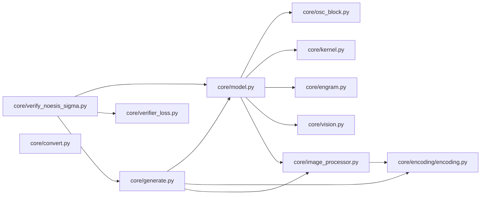

# NOESIS-Σ: Complete Module, Class & Function Reference

This document provides an exhaustive file-by-file and symbol-by-symbol reference for every module inside [`core/`](../core).

---

## 1. [`core/model.py`](../core/model.py): NOESIS-Σ Transformer Backbone

| Class / Function | Signature & Role |
| :--- | :--- |
| [`set_dtype(dtype)`](../core/model.py#L35-L42) | Context manager that temporarily sets `torch.get_default_dtype()` and restores it on exit. |
| [`ModelArgs`](../core/model.py#L46-L168) | Dataclass holding all architectural, precision, MLA, MoE, Hyper-Connections, Engram, Vision, DSpark, and OSC hyperparameters. Automatically converts JSON list fields to tuples in `__post_init__`. |
| [`ParallelEmbedding`](../core/model.py#L170-L197) | Vocabulary-sharded token embedding table (`vocab_size // world_size` rows per rank) with normal weight initialization ($\mathcal{N}(0, 0.02^2)$). |
| [`linear(x, weight, bias)`](../core/model.py#L200-L226) | Dispatches matrix multiplication by weight dtype: `fp4_gemm` for `float4_e2m1fn_x2`, `fp8_gemm` for `float8_e4m3fn`, and `F.linear` for `bfloat16`/`float32`. |
| [`Linear`](../core/model.py#L229-L265) | Quantization-aware linear layer supporting `bfloat16`, `float8_e4m3fn` (with per-block `scale`), and packed `float4_e2m1fn_x2`. |
| [`ColumnParallelLinear`](../core/model.py#L268-L279) | Shards `out_features` across tensor-parallel ranks. |
| [`RowParallelLinear`](../core/model.py#L282-L300) | Shards `in_features` across tensor-parallel ranks and performs an `fp32` `all_reduce` before adding `bias`. |
| [`RMSNorm`](../core/model.py#L303-L315) | Root-Mean-Square Layer Normalization computed in `float32` and cast back to input dtype. |
| [`ParallelEngramEmbedding`](../core/model.py#L318-L348) | Sharded FP8 $n$-gram embedding table with per-block scale dequantization on lookup. |
| [`Engram`](../core/model.py#L350-L388) | Projects hashed $n$-gram embeddings into per-Hyper-Connection keys and a shared value, gating the value into the residual stream via a normalized signed-sqrt sigmoid dot product. |
| [`precompute_freqs_cis(...)`](../core/model.py#L391-L411) | Precomputes complex rotary position frequencies (`torch.polar`), applying YaRN wavelength interpolation when `original_seq_len > 0`. |
| [`apply_rotary_emb(x, freqs_cis, inverse)`](../core/model.py#L414-L431) | Rotates adjacent feature pairs as complex numbers; supports inverse conjugation (`inverse=True`) and out-of-place autograd execution. |
| [`rotate_tail(x, rd, freqs_cis, inverse)`](../core/model.py#L434-L440) | Applies rotary embeddings exclusively to the trailing `rd` (`rope_head_dim`) dimensions of `x`. |
| [`get_window_topk_idxs(...)`](../core/model.py#L443-L460) | Computes causal sliding-window ring-buffer slot indices (`-1` for masked future/unfilled slots) for `sparse_attn`. |
| [`Compressor`](../core/model.py#L463-L519) | Pools `compress_ratio` consecutive tokens into a single compressed KV latent using a learned softmax gate (`wgate`), maintaining partial group state across decode steps. |
| [`Indexer`](../core/model.py#L522-L619) | Scores compressed KV latents using lightweight query heads and rectified weighted scores to select the top-`index_topk` historical compressed positions per query. |
| [`select_candidate_blocks(...)`](../core/model.py#L622-L645) | First stage of two-level sparse MLA indexing: selects the `topk_blocks` highest-scoring blocks of compressed KV positions and pins the newest partially filled block. |
| [`Attention`](../core/model.py#L648-L827) | Multi-Head Latent Attention (MLA) combining low-rank query/output projections, sliding-window KV ring buffer, optional compressed KV latents, and `sparse_attn` with learnable `attn_sink`. |
| [`Gate`](../core/model.py#L830-L866) | MoE router supporting `softmax`, `sigmoid`, and `sqrtsoftplus` scoring, separate text (`bias`) and vision (`bias_vl`) selection biases, and top-$k$ probability normalization. |
| [`Expert`](../core/model.py#L868-L889) | SwiGLU feed-forward expert (`w1`, `w2`, `w3`) with symmetric clamping on `up` and upper-bound clamping on `gate` (`swiglu_limit`). |
| [`MoE`](../core/model.py#L892-L942) | Mixture-of-Experts layer combining top-$k$ routed `Expert` modules (`index_add` autograd-safe accumulation) with an always-active `shared_experts` module. |
| [`Block`](../core/model.py#L945-L1033) | Transformer block operating on `hc_mult` Hyper-Connection residual copies using `hc_mixes`, `hc_pre`, and `hc_post`. |
| [`ParallelHead`](../core/model.py#L1036-L1056) | Vocabulary-parallel `float32` LM projection head (`full_logits=True` for full sequence training, `full_logits=False` for last-token generation). |
| [`DSparkAttention`](../core/model.py#L1070-L1113) | Speculative draft attention attending over the backbone's sliding-window KV cache plus the current draft block. |
| [`DSparkMarkovHead`](../core/model.py#L1116-L1125) | Low-rank token-to-token Markov transition bias head for speculative draft refinement. |
| [`DSparkConfidenceHead`](../core/model.py#L1128-L1136) | Linear confidence estimator predicting draft token acceptance probabilities. |
| [`DSparkBlock`](../core/model.py#L1139-L1196) | Multi-Token Prediction (`mtp`) speculative decoding stage. |
| [`Transformer` / `NoesisSigmaTransformer`](../core/model.py#L1224-L1364) | Complete NOESIS-Σ model providing `_run_backbone()`, `forward()` (inference), `forward_train()` (differentiable full-sequence training), and `forward_spec()` (speculative decoding). |
| [`sample(logits, temperature)`](../core/model.py#L1367-L1374) | Gumbel-max trick GPU token sampler (`argmax` when `temperature == 0`). |

---

## 2. [`core/osc_block.py`](../core/osc_block.py): Continuous Operator-Split Block

| Class / Method | Signature & Role |
| :--- | :--- |
| [`CanonicalICNNDirectGrad`](../core/osc_block.py#L30-L106) | Hybrid Input-Convex Neural Network potential $\Phi(\mathbf{x})$ with softplus ridges (`W`, `b`, `a_raw`), strong convexity diagonal (`D_raw`, `c_min`), low-rank coupling (`V`), and linear drift vector (`c`). |
| `CanonicalICNNDirectGrad.grad(x)` | Computes exact closed-form analytical gradient $\nabla\Phi(\mathbf{x})$ in a single forward pass without autograd graph construction. |
| `CanonicalICNNDirectGrad.energy(x)` | Computes mean scalar Lyapunov energy $\Phi(\mathbf{x})$. |
| [`RetrogradeController`](../core/osc_block.py#L109-L147) | Computes causal temporal difference feedback $\alpha\lambda(\mathbf{u}_t - \mathbf{u}_{t-1})$ with Input-to-State Stability (ISS) norm bound `u_max`. |
| [`OSCLatentAttractor`](../core/osc_block.py#L150-L240) | Operator-split block integrating the skew-symmetric operator $\mathbf{K} = \mathbf{U}\mathbf{V}^\top - \mathbf{V}\mathbf{U}^\top$, `CanonicalICNNDirectGrad`, context projection `b_proj`, `RetrogradeController`, and second-order symmetric Strang splitting. Returns `(output, metrics)`. |

---

## 3. [`core/verifier_loss.py`](../core/verifier_loss.py): Multi-Objective Verifier Loss

| Class / Method | Signature & Role |
| :--- | :--- |
| [`SigmaVerifierLoss`](../core/verifier_loss.py#L18-L70) | Computes $\mathcal{L}_{\text{total}} = \mathcal{L}_{\text{LM}} + \alpha \operatorname{ReLU}(\Delta\Phi) + \beta \mathcal{L}_{\text{smoothness}}$ and returns `(total_loss, loss_dict)` with keys `loss_total`, `loss_lm`, `loss_attractor`, and `loss_smoothness`. |

---

## 4. [`core/kernel.py`](../core/kernel.py): Attention, Sinkhorn, and Quantization Kernels

| Function | Signature & Role |
| :--- | :--- |
| [`act_quant(...)`](../core/kernel.py#L15-L33) | Block-wise FP8 activation quantization (`float8_e4m3fn`) and scale computation. |
| [`fp4_act_quant(...)`](../core/kernel.py#L36-L49) | Block-wise FP4 activation quantization and scale computation. |
| [`fp8_gemm(...)`](../core/kernel.py#L52-L75) | Per-block dequantizing FP8 matrix multiplication. |
| [`fp4_gemm(...)`](../core/kernel.py#L81-L109) | Unpacks `float4_e2m1fn_x2` nibble-packed weights via `_FP4_LUT`, applies block scales, and computes differentiable linear projection. |
| [`sparse_attn(...)`](../core/kernel.py#L112-L148) | Differentiable sparse multi-head latent attention gathering selected KV indices (`topk_idxs`) and incorporating learnable per-head `attn_sink` logits. |
| [`hc_split_sinkhorn(...)`](../core/kernel.py#L151-L188) | Projects Hyper-Connections stream statistics into `pre`, `post`, and doubly-stochastic `comb` matrices via Sinkhorn-Knopp normalization. |

---

## 5. [`core/engram.py`](../core/engram.py): $N$-Gram Hash Memory Tables

| Class / Function | Signature & Role |
| :--- | :--- |
| [`find_next_prime(start, seen_primes)`](../core/engram.py#L9-L14) | Finds the next unused prime modulus for disjoint $n$-gram hash buckets. |
| [`build_compressed_token_map(...)`](../core/engram.py#L17-L82) | Collapses case/whitespace/accent-equivalent tokens into a canonical compressed ID table. |
| [`compute_hash_multipliers(...)`](../core/engram.py#L85-L104) | Generates deterministic odd 64-bit hash multipliers per layer and lookback step. |
| [`EngramLayout`](../core/engram.py#L107-L138) | Immutable bucket layout storing prime moduli and table sizes across Engram layers. |
| [`NgramHashState`](../core/engram.py#L141-L196) | Stateful module maintaining rolling compressed token history across prefill/decode steps and outputting prime-bucketed XOR-product hash IDs. |

---

## 6. [`core/vision.py`](../core/vision.py) and [`core/image_processor.py`](../core/image_processor.py): Multimodal Vision Pipeline

| Symbol | File | Role |
| :--- | :--- | :--- |
| [`get_vision_cos_sin`](../core/vision.py#L9-L15), [`apply_rotary`](../core/vision.py#L18-L21) | `core/vision.py` | 2D axial rotary embeddings for variable-resolution image patch grids. |
| [`PatchEmbed`](../core/vision.py#L37-L43), [`Attention`](../core/vision.py#L46-L60), [`MLP`](../core/vision.py#L63-L71), [`Block`](../core/vision.py#L74-L84), [`ViT`](../core/vision.py#L87-L105) | `core/vision.py` | Bidirectional Vision Transformer tower over `n_vit_h x n_vit_w` patches. |
| [`Aligner`](../core/vision.py#L108-L120) | `core/vision.py` | `3x3` spatial unfold downsampler + 2-layer GELU projection into LLM hidden dimension `dim`. |
| [`plan_image_grid`](../core/image_processor.py#L105-L116), [`safe_resize`](../core/image_processor.py#L64-L71), [`solve_resize_ratio`](../core/image_processor.py#L50-L61) | `core/image_processor.py` | Aspect-ratio-preserving image resolution planner bounded by `vision_max_n_token`. |
| [`load_image_bytes`](../core/image_processor.py#L74-L102), [`load_image`](../core/image_processor.py#L119-L133), [`prepare_vl_inputs`](../core/image_processor.py#L144-L177) | `core/image_processor.py` | Loads images from bytes/base64/data-URL/HTTP/file and expands `<｜image｜>` placeholders into typed token spans. |

---

## 7. [`core/generate.py`](../core/generate.py), [`core/convert.py`](../core/convert.py) & [`core/encoding/encoding.py`](../core/encoding/encoding.py)

| Module | Key Functions & Capabilities |
| :--- | :--- |
| [`core/generate.py`](../core/generate.py) | [`generate()`](../core/generate.py#L37-L95) (batched right-padded prefill + token-by-token decode), [`prepare_case()`](../core/generate.py#L98-L104), and [`main()`](../core/generate.py#L107-L205) (interactive REPL and batch JSON/TXT generation). |
| [`core/convert.py`](../core/convert.py) | [`cast_e2m1fn_to_e4m3fn()`](../core/convert.py#L28-L63) (lossless FP4-to-FP8 block conversion), [`infer_num_experts()`](../core/convert.py#L77-L87), and [`main()`](../core/convert.py#L90-L200) (multi-rank `mp` checkpoint sharding). |
| [`core/encoding/encoding.py`](../core/encoding/encoding.py) | [`encode_messages()`](../core/encoding/encoding.py#L810-L845), [`encode_case()`](../core/encoding/encoding.py#L872-L883), [`parse_message_from_completion_text()`](../core/encoding/encoding.py#L946-L990), [`parse_tool_calls()`](../core/encoding/encoding.py#L890-L943), [`merge_tool_messages()`](../core/encoding/encoding.py#L184-L230), and reasoning-effort budget formatting (`1-100`). |

---

## 8. [`scripts/run_ablation_study.py`](../scripts/run_ablation_study.py) & [`tests/test_ablation_study_suite.py`](../tests/test_ablation_study_suite.py)

| File / Symbol | Role & Description |
| :--- | :--- |
| [`scripts/run_ablation_study.py`](../scripts/run_ablation_study.py) | Automated five-stage ablation runner for Baseline, OSC, MLA, Hyper-Connections, and the full harness configuration. Measures initial and final loss, perplexity, KV-cache footprint, tokens per second, $\|\nabla\Phi(\mathbf{x})\|$, and $\Delta E$. Writes Markdown and LaTeX tables. |
| `get_ablation_model_args(variant_id)` | Factory generating strictly matched Iso-Compute `ModelArgs` for the 5-variant ladder. |
| `compute_kv_cache_footprint_mb(args)` | Calculates exact theoretical KV-cache VRAM allocation in Megabytes (MB). |
| `run_automated_ablation_study(...)` | Executes end-to-end multi-variant training, evaluates metrics, and writes `docs/ablation_results.md`. |
| [`tests/test_ablation_study_suite.py`](../tests/test_ablation_study_suite.py) | Automated PyTest suite asserting memory reductions, continuous energy dissipation ($\Delta E < 0$), and printing live tables for CI/CD audits. |
