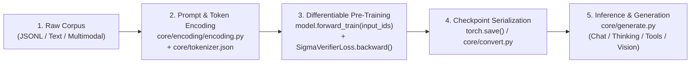

# NOESIS-Σ: End-to-End Pre-Training, Checkpointing & Inference Guide

This guide walks through preparing any text or multimodal corpus, training [`NoesisSigmaTransformer`](../core/model.py#L1224-L1364) with [`SigmaVerifierLoss`](../core/verifier_loss.py#L18-L70), saving/converting checkpoints, and running interactive or batch inference.



---

## 1. Environment & Pre-Flight Verification

Before starting a pretraining run, verify the accelerator, model backbone,
operator-split block, and test suite:

```bash
# 1. Quick 5-stage hardware, training & generation check
.venv/bin/python3 core/verify_noesis_sigma.py

# 2. Full current automated test suite
.venv/bin/python3 -m pytest -q --tb=short

# 3. Automated 5-stage ablation study across shared multi-domain corpus
.venv/bin/python3 scripts/run_ablation_study.py --steps 50 --corpus examples/pretraining_corpus.txt
```

---

## 2. Pre-Training on Any Corpus

[`NoesisSigmaTransformer.forward_train(input_ids, images=None, token_types=None)`](../core/model.py#L1343-L1349) executes a fully differentiable forward pass across the entire sequence (`full_logits=True`) and returns:
1. `logits` (`[B, S, V]` in `float32`)
2. `osc_metrics` (`dict` containing `initial_energy`, `final_energy`, and `energy_delta`)
3. `hidden_states` (`[B, S, D]` normalized final representations for Lipschitz smoothness regularization)

### Complete Pre-Training Loop Example

```python
import json
import sys
import torch
from torch.utils.data import DataLoader, TensorDataset

sys.path.insert(0, "core")
sys.path.insert(0, "core/encoding")

from model import ModelArgs, NoesisSigmaTransformer
from verifier_loss import SigmaVerifierLoss

# 1. Load a repository configuration
device = torch.device("cuda" if torch.cuda.is_available() else "cpu")
torch.set_default_device(device)
torch.set_default_dtype(torch.bfloat16)

with open("core/config_1.5b_256k.json", "r", encoding="utf-8") as f:
    args = ModelArgs(**json.load(f))

# 2. Instantiate Unified NOESIS-Σ Model & Multi-Objective Verifier Loss
model = NoesisSigmaTransformer(args).to(device)
criterion = SigmaVerifierLoss(
    alpha_attractor=0.05,  # Weight on ReLU(ΔΦ) Lyapunov attractor dissipation
    beta_smoothness=0.01,  # Weight on temporal Lipschitz smoothness ||h_t - h_{t-1}||_2
).to(device)

optimizer = torch.optim.AdamW(
    model.parameters(),
    lr=3e-4,
    betas=(0.9, 0.95),
    weight_decay=0.01,
)

# 3. Training Step over Tokenized Corpus Batches [B, S]
model.train()
input_ids = torch.randint(0, args.vocab_size, (4, 128), device=device)
target_ids = torch.roll(input_ids, shifts=-1, dims=1)
target_ids[:, -1] = -100  # Mask final position or padding tokens with -100

optimizer.zero_grad()
logits, osc_metrics, hidden_states = model.forward_train(input_ids)
total_loss, loss_dict = criterion(
    logits=logits,
    targets=target_ids,
    osc_metrics=osc_metrics,
    hidden_states=hidden_states,
)

total_loss.backward()
torch.nn.utils.clip_grad_norm_(model.parameters(), max_norm=1.0)
optimizer.step()

print(
    f"loss_total={loss_dict['loss_total']:.4f} | "
    f"loss_lm={loss_dict['loss_lm']:.4f} | "
    f"OSC ΔΦ={float(osc_metrics['energy_delta'].item()):.4f}"
)
```

---

## 3. Formatting Chat, Reasoning & Tool-Use Data (`core/encoding/`)

Use [`core/encoding/encoding.py`](../core/encoding/encoding.py) to format conversational, reasoning-effort, tool-calling, and multimodal training or inference examples:

```python
import encoding as enc

messages = [
    {"role": "system", "content": "You are NOESIS-Σ, a continuous-time reasoning assistant."},
    {"role": "user", "content": "Derive the conservation law of a skew-symmetric operator K."},
]

# Render with Reasoning Effort budget (1..100 or "low" / "high" / "max")
prompt = enc.encode_messages(
    messages,
    thinking_mode="thinking",
    reasoning_effort="high",  # Emits "<｜System｜>Reasoning Effort: 75 ..."
)
```

See [`examples/example_harmony.json`](../examples/example_harmony.json) and [`examples/example.txt`](../examples/example.txt) for ready-to-use multi-turn, vision-language, and tool-calling templates.

---

## 4. Saving & Sharding Checkpoints

### Standard PyTorch Checkpoint Save/Load
```python
torch.save(
    {
        "model_state_dict": model.state_dict(),
        "optimizer_state_dict": optimizer.state_dict(),
        "config": vars(args),
    },
    "noesis_sigma_ckpt.pt",
)
```

### Multi-Rank Safetensors Sharding (`core/convert.py`)
To shard a HuggingFace-formatted `.safetensors` directory across `M` model-parallel ranks (`model0-mpM.safetensors ..`):

```bash
.venv/bin/python3 core/convert.py \
    --hf-ckpt-path /path/to/exported_ckpt \
    --save-path /path/to/sharded_ckpt \
    --model-parallel 2 \
    --expert-dtype fp8
```

---

## 5. Autoregressive & Speculative Inference (`core/generate.py`)

### Programmatic Generation
```python
from generate import generate

model.eval()
with torch.inference_mode():
    completions = generate(
        model=model,
        prompt_tokens=[[101, 2054, 3210], [101, 8842]],
        max_new_tokens=64,
        eos_id=1,
    )
```

### CLI Batch & Interactive Modes (`core/run.sh` / `core/generate.py`)
```bash
# Export an FSDP training checkpoint into an inference directory
.venv/bin/python3 scripts/export_checkpoint.py \
    --checkpoint checkpoints/noesis_sigma_1.5b \
    --output-dir checkpoints/noesis_sigma_1.5b/exported

# Batch inference on OpenAI/Harmony JSON cases (thinking mode)
.venv/bin/python3 core/generate.py \
    --ckpt-path checkpoints/noesis_sigma_1.5b/exported \
    --input-file examples/example_harmony.json \
    --thinking-mode thinking \
    --max-new-tokens 65536 \
    --prefill-chunk 8192

# Interactive chat session
.venv/bin/python3 core/generate.py \
    --ckpt-path checkpoints/noesis_sigma_1.5b/exported \
    --interactive
```

`--config` is optional when the checkpoint directory contains `config.json`,
as exported directories do. `prompt_tokens + max_new_tokens` must fit inside
the configured `max_seq_len`; 64K to 128K outputs require an explicit
`--max-new-tokens`. `--truncate-prompt` left-truncates over-budget text-only
prompts, and `--stop-token-ids` / `--stop-strings` stop each sample early.
